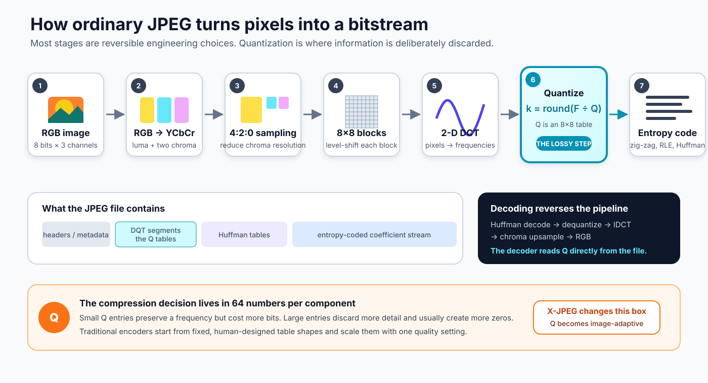
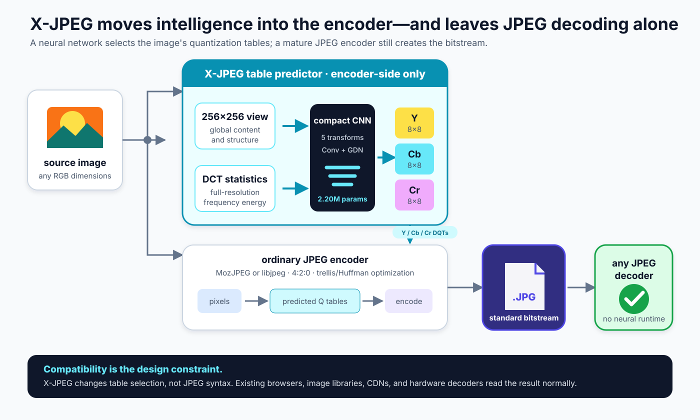
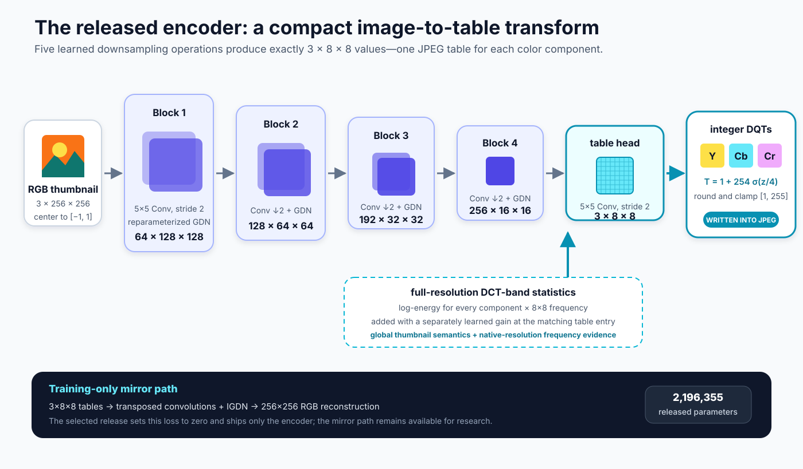
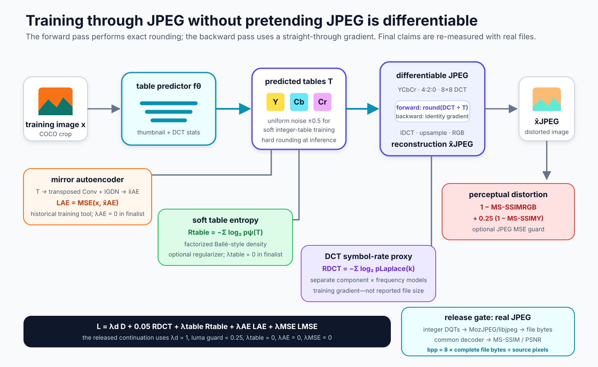
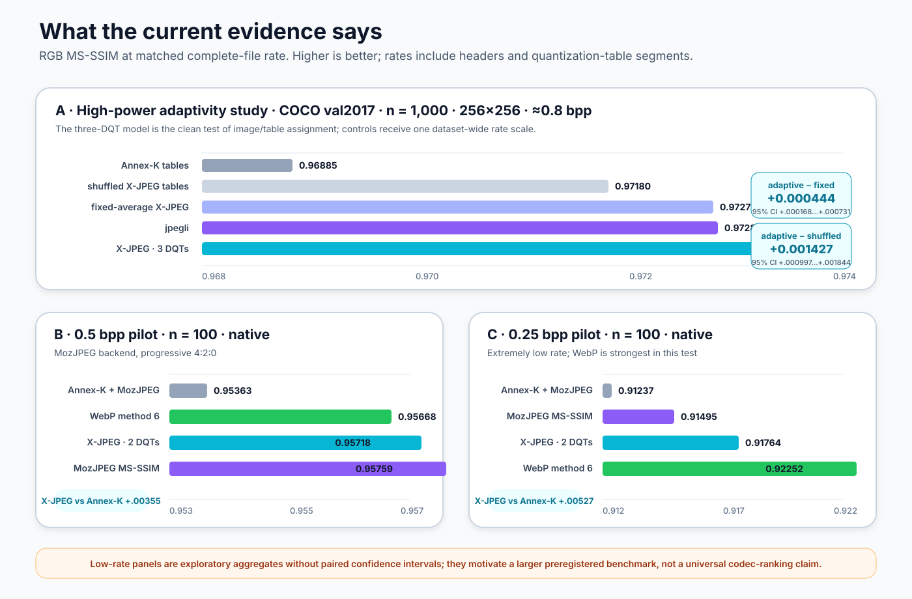

# Extending JPEG with neural networks (X-JPEG): Image-adaptive quantization with neural networks for JPEG

**Migel Tissera**<br>
Trinity Cloud<br>
Technical report, 4 August 2026

Project: [github.com/trinity-cloud/x-jpeg](https://github.com/trinity-cloud/x-jpeg)<br>
Model: [huggingface.co/migtissera/x-jpeg](https://huggingface.co/migtissera/x-jpeg)<br>
Package: [pypi.org/project/xjpeg](https://pypi.org/project/xjpeg/)

## Abstract

JPEG is universally deployable because its bitstream and decoder are already embedded in browsers, operating systems, cameras, content-delivery networks, and hardware. Its encoder, however, must decide how strongly to quantize each of the 64 spatial-frequency coefficients in every color component. Conventional encoders begin with fixed, human-designed quantization-table shapes and expose a scalar quality control. We recast table selection as an image-conditioned prediction problem.

X-JPEG is an encoder-side neural extension that predicts three 8×8 quantization tables—one each for Y, Cb, and Cr—from the source image. A 2.20-million-parameter convolutional analysis transform combines a 256×256 image view with full-resolution DCT-band statistics. The predicted integer tables are passed to an ordinary JPEG encoder; the resulting file is a standards-compliant JPEG and requires no neural or custom decoder. Training uses a differentiable JPEG forward model, exact-forward straight-through rounding, RGB MS-SSIM with a luma guard, and a learned DCT-symbol rate proxy. A mirror IGDN decoder and a soft factorized table-entropy model remain available as training regularizers, although ablation selected zero weight for both in the released continuation.

On 1,000 held-out COCO val2017 images in a controlled 256×256 evaluation at approximately 0.8 complete-file bits per pixel (bpp), the released three-table model reaches 0.97322 RGB MS-SSIM. It exceeds its fixed-average-table control by 0.000444 (paired 95% bootstrap confidence interval 0.000168 to 0.000731) and its shuffled-table control by 0.001427 (0.000997 to 0.001844), establishing that the image/table assignment—not merely a learned global table shape—contributes to quality. A two-emitted-table deployment path reaches 0.97345 RGB MS-SSIM versus 0.97282 for jpegli at nearly identical rate, a paired difference of 0.000628 (0.000389 to 0.000871), while jpegli remains better on luma-only MS-SSIM. An exploratory 100-image native-resolution study finds that X-JPEG improves over Annex-K tables used with the same MozJPEG backend by 0.00355 RGB MS-SSIM near 0.5 bpp and 0.00527 near 0.25 bpp. WebP remains strongest in the 0.25-bpp pilot. These results support image-adaptive JPEG table prediction as a practical compatibility-preserving direction, while motivating a larger multi-dataset low-rate evaluation.

## 1. Introduction

Learned image compression has produced strong rate–distortion results, but most learned codecs replace the bitstream, the decoder, or both. That trade can be appropriate in a closed system. It is harder to deploy across the open web, where JPEG's accumulated compatibility is itself a product feature.

This work starts from a different constraint: **the decoder and the file format must remain ordinary JPEG**. The neural network may spend computation while encoding, but it must leave behind only information a standard decoder already understands. Quantization tables are an unusually attractive intervention point. They are explicit encoder decisions, carried inside standard Define Quantization Table (DQT) segments, and consumed by every conforming decoder [1,2].

Traditional JPEG quantization tables are fixed frequency-shaping priors. A quality setting usually scales those priors but does not reconsider their shape for the current image. Yet a portrait, a foliage scene, an illustration, and a night photograph distribute energy and perceptual importance differently across frequency and color. X-JPEG asks a direct question: can a neural network predict a better table shape for each image while preserving the rest of JPEG?

The answer requires more than observing that predicted tables vary. A model can collapse to one learned global table, or emit arbitrary image-dependent variation that an operating-point search later hides. We therefore treat **useful adaptivity** as a causal experimental claim. The correctly paired image and table must beat both (i) the average predicted table and (ii) tables assigned to the wrong images, at a common dataset-wide rate control. The released model passes both controls on 1,000 held-out images.

Our contributions are:

1. An encoder-only neural extension that predicts image-specific JPEG quantization tables while producing standard JPEG files.
2. A compact three-table architecture that combines a 256×256 semantic view with frequency-aligned, full-resolution DCT statistics.
3. A JPEG-aware training graph with exact-forward straight-through quantization, perceptual distortion, learned DCT-rate estimation, an optional soft table-entropy constraint, and an optional mirror autoencoder.
4. A real-file evaluation protocol that counts complete file bytes and includes fixed-average and shuffled-table controls for adaptivity.
5. An open-source implementation, cross-platform Python package, released model, pinned codec backends, and reproducible benchmark artifact.

This report concerns the independently trained 2026 release. It does not report results from, nor distribute weights belonging to, the earlier private implementation that motivated the reconstruction.



**Figure 1.** Baseline JPEG encoding. Quantization is the central lossy decision. The Q tables are written into the JPEG file, so changing how an encoder selects them does not require a new decoder.

## 2. JPEG as a compatibility-constrained optimization problem

### 2.1 Baseline pipeline

JPEG commonly transforms an RGB image into one luma and two chroma components, subsamples chroma (4:2:0 in our experiments), level-shifts the samples, and divides each component into non-overlapping 8×8 blocks [1,2]. For a block \(B\), the two-dimensional discrete cosine transform (DCT) is

\[
F = D B D^\top,
\]

where \(D\) is the orthonormal 8-point DCT matrix. Given component-specific quantization table \(Q\), the encoder transmits integer symbols

\[
K_{u,v} = \operatorname{round}\left(\frac{F_{u,v}}{Q_{u,v}}\right).
\]

The decoder reconstructs \(\hat F = K \odot Q\), applies the inverse DCT, upsamples chroma, and converts back to RGB. Zig-zag ordering, run-length coding, DC prediction, and Huffman or arithmetic coding compress the quantized symbols without adding further distortion.

Small entries of \(Q\) preserve a frequency more accurately but generally require more bits; large entries discard more information and increase the probability of zero symbols. JPEG allows the tables to be transmitted in the bitstream. They are therefore part of the encoder's optimization problem rather than immutable decoder behavior.

### 2.2 What “adaptive” means here

X-JPEG predicts one set of tables per source image. Those tables are global within that image and component. This is **image-adaptive**, not block-adaptive: every luma block shares the predicted Y table, and every chroma block uses the relevant predicted chroma table. This distinction preserves ordinary JPEG syntax but cannot perform the spatial bit allocation available to codecs with segmentation or block-level quantization controls, such as lossy WebP [15].

### 2.3 Rate definition

All reported rates use complete output files:

\[
\mathrm{bpp} = \frac{8\,|\text{encoded file in bytes}|}{H W}.
\]

The numerator includes JPEG headers, DQT payloads, Huffman tables, scan headers, and entropy-coded data. We do not divide by three color components. Thus 0.8 bpp means 0.8 compressed bits per RGB pixel location, relative to 24 uncompressed bits for an 8-bit RGB source.

## 3. Related work

### 3.1 Learned image compression

Ballé, Laparra, and Simoncelli introduced end-to-end learned analysis and synthesis transforms with generalized divisive normalization (GDN) and continuous relaxations of quantization [4,5]. Hyperprior models later improved learned entropy estimates by transmitting side information [6]. These systems established that learned nonlinear transforms and learned probability models can outperform traditional codecs under selected distortion metrics. They generally require their own decoder and bitstream, whereas X-JPEG deliberately retains JPEG's transform, syntax, and installed decoder base.

### 3.2 Differentiable JPEG

JPEG contains discontinuous rounding and discrete entropy coding. Straight-through estimators provide a practical gradient surrogate for hard operations [7]. Several differentiable JPEG implementations approximate the codec; Reich et al. show that color conversion, subsampling, rounding, boundary conventions, and rate details materially affect fidelity to a real implementation [8]. X-JPEG uses a compact differentiable forward model during optimization but treats it as a training instrument: every reported operating point is encoded again with a real JPEG implementation and measured from actual file bytes.

### 3.3 Neural modifications of standard JPEG

DeepN-JPEG optimizes JPEG quantization for downstream neural-network classification rather than human-perceptual reconstruction [9]. Li et al. similarly optimize tables for classification networks [10]. Neural JPEG jointly learns frequency-domain pre/post-editing and tables, improving rate–distortion performance while placing learned processing on both encoder and decoder sides [11].

X-JPEG occupies a narrower compatibility point. Its deployed neural computation only selects standard DQT values. It performs no learned prefiltering that a decoder must reverse and no learned post-processing after decoding. The closest comparison is therefore not a general learned codec but an alternative JPEG encoder policy.



**Figure 2.** X-JPEG's deployment boundary. The source pixels and predicted tables enter a mature JPEG encoder. The output is a normal `.jpg`; no model is required to decode it.

## 4. Method

### 4.1 Image-conditioned table prediction

Let \(x\) be an RGB image of arbitrary dimensions. X-JPEG predicts

\[
T_\theta(x) = \left(Q^Y, Q^{Cb}, Q^{Cr}\right), \qquad Q^c \in \{1,\ldots,255\}^{8\times 8}.
\]

The predictor receives two complementary views:

- A bicubic 256×256 RGB thumbnail captures scene structure, color, and global content.
- A 3×8×8 full-resolution statistic tensor summarizes log-energy for every color component and DCT frequency over the native image. These values preserve evidence that thumbnailing can erase, particularly high-frequency energy and resolution-dependent texture.

The released compact encoder consists of four 5×5 stride-2 convolution + reparameterized GDN blocks with widths 64, 128, 192, and 256. They map spatial dimensions 256 → 128 → 64 → 32 → 16. A final 5×5 stride-2 convolution directly emits 3×8×8 raw table codes. The full-resolution statistic at component \(c\) and frequency \((u,v)\) is added to the matching raw code with a learned elementwise gain. This frequency-aligned addition avoids convolving adjacent DCT bands as if they were spatial neighbors.

Raw codes \(z\) map to legal table values through

\[
T(z)=1+254\,\sigma(z/4).
\]

During table-entropy training, uniform noise \(\mathcal U(-\tfrac12,\tfrac12)\) relaxes integer table values; inference rounds and clamps them to \([1,255]\). The released encoder contains 2,196,355 parameters.



**Figure 3.** Released model architecture. The mirror IGDN decoder is a training-only component and is not distributed as part of inference.

### 4.2 Three predicted tables and two deployment modes

The network predicts independent Y, Cb, and Cr tables. Baseline JPEG supports three DQT selectors, so all three can be emitted directly. For small files, however, the third DQT costs roughly 65 bytes before any scan data. The default product path averages the two predicted chroma tables at the encoding boundary and emits Y plus shared chroma. Crucially, the predictor still produces three tables; `share_chroma` is a deployment trade-off, not a two-output model.

The three-DQT path is the clearest adaptivity experiment because it preserves every predicted table. The two-DQT path is often the better product choice for small images because it recovers header budget.

### 4.3 Differentiable JPEG

The training codec follows RGB → YCbCr → 4:2:0 subsampling → 8×8 DCT → table division → quantization → dequantization → inverse DCT → chroma upsampling → RGB. For a scaled coefficient \(s=F/Q\), straight-through rounding is

\[
\operatorname{STEround}(s)=s+\operatorname{stopgrad}(\operatorname{round}(s)-s).
\]

Its forward value is exact integer rounding and its surrogate backward derivative is one. This prevents the predictor from exploiting a smooth forward approximation that preserves fractional signal a real JPEG would discard.

### 4.4 Rate and distortion objective

The general training objective is

\[
\begin{aligned}
\mathcal L ={}& \lambda_d \Big[(1-\operatorname{MS\text{-}SSIM}_{RGB})
+\lambda_L(1-\operatorname{MS\text{-}SSIM}_{Y})\Big] \\
&+\lambda_r R_{DCT}+\lambda_T R_{table}
+\lambda_{AE}\mathcal L_{AE}+\lambda_{MSE}\mathcal L_{MSE}.
\end{aligned}
\]

The released continuation uses \(\lambda_d=1\), \(\lambda_L=0.25\), \(\lambda_r=0.05\), and zero final weights for table entropy, the mirror autoencoder, and JPEG MSE.

**DCT-symbol rate.** For each component and DCT frequency, a learned Laplace density estimates the probability mass of the relaxed quantized coefficient:

\[
R_{DCT}=-\sum_i \log_2 P_\phi(k_i-\tfrac12 < K_i < k_i+\tfrac12).
\]

The proxy omits JPEG's exact DC differencing, zero-run symbols, categories, optimized Huffman lengths, and header cost. It supplies a useful training direction but is never reported as bitrate.

**Soft table entropy.** A Ballé-style fully factorized density can estimate

\[
R_{table}=-\sum_j \log_2 P_\psi(T_j-\tfrac12<T_j<T_j+\tfrac12).
\]

In an ordinary JPEG, DQT entries are stored literally rather than entropy-coded by this model. The term is consequently a representation regularizer, not a realized file-size saving. Ablation found no product benefit and selected \(\lambda_T=0\) for the finalist.

**Mirror autoencoder.** The historical reconstruction includes a decoder that maps the 3×8×8 table bottleneck through transposed convolutions and inverse GDN (IGDN) to a 256×256 RGB reconstruction. This path can encourage image conditioning before JPEG pressure is applied. It is optional, absent from deployment, and has zero loss weight in the released continuation.



**Figure 4.** Training graph and release gate. Proxy losses make optimization possible; a real encoder, complete file size, and common decoder determine every release metric.

### 4.5 Real encoder and operating-point control

At deployment the tables are scaled by a positive scalar \(s\), rounded, clamped, and handed to MozJPEG or libjpeg. The public API can search \(s\) per image for a requested bpp or minimum RGB MS-SSIM. For scientific adaptivity tests, all images in a method share one dataset-wide scale. This prevents per-image rate search from compensating for an incorrectly assigned table.

The default wheel bundles a pinned MozJPEG build. MozJPEG retains standard JPEG compatibility while adding trellis quantization, optimized Huffman coding, progressive scan optimization, and perceptual table presets [13]. X-JPEG and MozJPEG solve different layers of the encoder problem: X-JPEG proposes the image-conditioned table shape; MozJPEG efficiently codes coefficients under that shape.

## 5. Experiments

### 5.1 Training and model selection

The release model was trained on COCO train2017 [12] using random 256×256 crops. The selected product stage adds full-resolution DCT-band statistics and a 0.25-weight luma MS-SSIM guard. Its final selection lineage contains a 2,500-step product run followed by a 5,000-step continuation with batch size 96, learning rate \(10^{-4}\), and entropy/rate-model learning rate \(10^{-3}\). It was initialized from an earlier RGB, rate-weight-0.05 model. Model selection included fixed-table, wrong-image, table-entropy, DCT-statistic, chroma-sharing, and width ablations. The released weight artifact is exactly the encoder evaluated below.

### 5.2 Evaluation protocol

We use held-out COCO val2017 images under two domains:

- **256 domain:** the source is evaluated at 256×256, matching the historical target and enabling tightly controlled adaptivity comparisons.
- **Native domain:** the source retains native resolution. Images too small for canonical five-scale MS-SSIM are excluded before deterministic sampling.

All encoders receive identical lossless pixels, use 4:2:0 chroma sampling, and are decoded through one Pillow/libjpeg path. We report complete-file bpp, canonical five-scale RGB MS-SSIM [3], luma MS-SSIM, a 6:1:1 Y:Cb:Cr MS-SSIM aggregate, and RGB PSNR. A single dataset-wide operating parameter is selected for each method.

The high-power comparison uses 1,000 images. Baselines include libjpeg-turbo with Annex-K table shapes and jpegli. The exploratory low-rate benchmark uses 100 native-resolution images and compares X-JPEG tables under MozJPEG, Annex-K tables under the same MozJPEG backend, MozJPEG's MS-SSIM-tuned mode, and WebP method 6. MozJPEG is pinned at commit `08265790774cd0714832c9e675522acbe5581437`; jpegli is pinned at `031a0077f5799a6041004267fc12b956c1f52a20`.

### 5.3 High-power result near 0.8 bpp

| Encoder, COCO-val-1000, 256 domain | bpp | RGB MS-SSIM ↑ | Y MS-SSIM ↑ | 6:1:1 ↑ | PSNR ↑ |
|---|---:|---:|---:|---:|---:|
| libjpeg-turbo / Annex-K | 0.7979 | 0.96874 | **0.98592** | 0.97682 | 29.00 dB |
| X-JPEG, three emitted DQTs | 0.7985 | 0.97322 | 0.98269 | 0.98017 | 29.44 dB |
| **X-JPEG, shared emitted chroma DQT** | **0.7981** | **0.97345** | 0.98305 | **0.98047** | **29.50 dB** |
| jpegli | 0.7986 | 0.97282 | 0.98572 | 0.97935 | 29.26 dB |

The shared-chroma deployment path exceeds jpegli by 0.000628 paired RGB MS-SSIM (95% bootstrap CI 0.000389 to 0.000871) while using 0.00050 fewer bpp. It also gains 0.00111 in mean 6:1:1 MS-SSIM and 0.23 dB RGB PSNR. This is a result under the declared RGB-oriented objective, not a universal quality win: jpegli is 0.00267 higher on luma-only MS-SSIM.

On native-resolution COCO-val-1000, three-DQT X-JPEG reaches 0.79981 bpp / 0.97022 RGB MS-SSIM versus jpegli at 0.79985 / 0.96892. The paired RGB difference is 0.001299 (95% CI 0.000970 to 0.001635). X-JPEG is 0.00096 higher on 6:1:1 MS-SSIM and 0.11 dB higher on RGB PSNR; jpegli remains 0.00221 higher on luma MS-SSIM.

### 5.4 Does the network really use the image?

The released three-table predictor has a mean per-entry standard deviation of 7.923 table units across the 1,000-image set, or 21.266% relative variation. Variation alone is insufficient evidence, so we compare:

- **Adaptive:** each image receives its own predicted table.
- **Fixed average:** every image receives the dataset-average predicted table.
- **Shuffled:** each image receives a different image's predicted table.
- **Annex-K:** every image receives standard table shapes.

| Method, common dataset-wide scale | bpp | RGB MS-SSIM ↑ | Y MS-SSIM ↑ | PSNR ↑ |
|---|---:|---:|---:|---:|
| adaptive X-JPEG | 0.7985 | **0.97322** | 0.98269 | **29.44 dB** |
| fixed-average X-JPEG | 0.7984 | 0.97278 | 0.98233 | 29.35 dB |
| shuffled X-JPEG | 0.7987 | 0.97180 | 0.98150 | 29.29 dB |
| Annex-K | 0.7989 | 0.96885 | **0.98594** | 29.01 dB |

Adaptive minus fixed-average is +0.000444 RGB MS-SSIM (95% CI +0.000168 to +0.000731); adaptive minus shuffled is +0.001427 (+0.000997 to +0.001844). Both paired intervals exclude zero. The predictor therefore contributes more than a strong global table: matching each table to the image matters.

### 5.5 Exploratory low-rate behavior

| Encoder, native COCO-val-100 | bpp @ 0.5 target | RGB MS-SSIM ↑ | bpp @ 0.25 target | RGB MS-SSIM ↑ |
|---|---:|---:|---:|---:|
| **X-JPEG, two DQTs + MozJPEG** | 0.49975 | 0.95718 | 0.25111 | 0.91764 |
| X-JPEG, three DQTs + MozJPEG | 0.49917 | 0.95693 | 0.25002 | 0.91642 |
| Annex-K + MozJPEG | 0.50097 | 0.95363 | 0.25000 | 0.91237 |
| MozJPEG, MS-SSIM tuned | 0.50618 | **0.95759** | 0.24472 | 0.91495 |
| WebP, method 6 | 0.50015 | 0.95668 | 0.24996 | **0.92252** |

At 0.5 bpp, two-DQT X-JPEG is +0.00355 RGB MS-SSIM over Annex-K under the same MozJPEG backend. It is +0.00050 over WebP and −0.00041 below MozJPEG's tuned mode, although the MozJPEG point is 0.00643 bpp higher. At 0.25 bpp, X-JPEG is +0.00527 over Annex-K and +0.00268 over the measured MozJPEG point, but WebP is +0.00488 ahead of X-JPEG. The X-JPEG gain over the fixed JPEG table is larger at 0.25 than at 0.5 bpp, consistent with the hypothesis that table shape matters more under a severe bit budget.

This low-rate study is a 100-image aggregate and does not yet include paired confidence intervals. It is evidence for a larger experiment, not a durable ranking of X-JPEG, MozJPEG, and WebP.



**Figure 5.** Evidence summary. The adaptivity panel uses 1,000 images and paired bootstrap intervals. Low-rate panels use 100 images and are labeled exploratory.

## 6. Ablation findings

Several negative results shaped the release:

**Frequency-aligned native statistics.** Adding full-image DCT-band statistics improved the direct libjpeg path over equally trained no-stat controls by approximately +0.00054 RGB MS-SSIM at 0.8 bpp and +0.00080 at 0.5 bpp. On COCO-val-1000 near 0.5 bpp, the statistics model reaches 0.95384 versus 0.95328 fixed-average and 0.95170 shuffled; adaptive minus fixed is +0.000564 (95% CI +0.000118 to +0.001004). Learned statistic gains move materially away from initialization, indicating that this side channel is active.

**Table entropy.** Keeping the soft table-entropy weight at 0.01 versus turning it off produced numerically indistinguishable product results. This matches the file format: a standard JPEG stores each DQT entry literally. The mechanism remains useful for reconstructing the historical training design, but the release continuation sets its weight to zero.

**Mirror decoder.** The autoencoder objective is not necessary for the selected product continuation. A small nonzero bottleneck-head initialization and direct adaptive controls were more important to avoiding a global-table collapse. The decoder remains available for research but is not shipped.

**Model width.** A controlled two-times-width run did not improve the measured frontier within its training budget. This prevents the unsupported conclusion that a larger table predictor automatically produces better JPEGs; optimization and the information supplied to the predictor matter at least as much as parameter count.

**Third-table overhead.** Three independent chroma/luma outputs are useful for studying the complete predictor, but the third DQT can be counterproductive for small images. Averaging Cb/Cr only at emission often improves complete-file rate–distortion because it saves approximately 65 bytes.

## 7. Limitations and threats to validity

1. **Metric specialization.** The final model is optimized primarily for RGB MS-SSIM with a 0.25 luma guard. It can lead on RGB while trailing another encoder on luma. Applications should inspect more than one metric and conduct visual evaluation.
2. **Image-global tables.** JPEG DQT compatibility limits adaptivity to one table per component per image. X-JPEG cannot redistribute quantization spatially across blocks.
3. **Training-rate mismatch.** The Laplace DCT proxy omits important parts of JPEG entropy coding. Mature encoders such as MozJPEG may alter the relative value of a table through trellis decisions. Real-file validation is therefore mandatory.
4. **Dataset scope.** Training and most evaluation use natural photographic images from COCO. Medical, scientific, synthetic, text-heavy, scanned, adversarial, and out-of-distribution imagery remain uncharacterized.
5. **Low-rate statistical power.** The 0.5/0.25-bpp codec comparison uses only 100 images and lacks paired intervals. A release-quality cross-codec claim requires larger, diverse datasets and a preregistered matching protocol.
6. **Encoder cost.** On an Intel Xeon Platinum 8480+, table prediction including full-resolution DCT statistics takes 10.4 ms median / 13.0 ms p95 on a 50-image native COCO subset with median 0.273 megapixels; stock JPEG encoding adds 1.5 ms median / 2.5 ms p95. Different hardware and large images require independent measurement.
7. **Model distribution.** Decoding is model-free, but encoding requires a roughly 8.4 MB weight artifact and a PyTorch runtime in the current package.
8. **Operating-point search.** Per-image target-bpp search performs multiple real encodes. It is convenient but increases latency and must not be confused with evidence of table adaptivity.
9. **One released checkpoint.** Model-selection experiments are extensive, but final-checkpoint seed variability has not yet been characterized.

## 8. Reproducibility and release boundary

Version 0.1.0 is available under the MIT License:

- Source: `trinity-cloud/x-jpeg`
- Python package: `pip install xjpeg`
- Model repository: `migtissera/x-jpeg`
- Released Safetensors SHA-256: `823a305b9cdf6d16e2296644d88a343dfc68621fa8e3d4b3c0125772c50b92e8`
- Source encoder-checkpoint SHA-256: `5878df379ff23dbfa1c1e753d0a70d2b131e4625cc20be2b61fc882789304219`
- Public benchmark: `benchmarks/coco100-lowrate.json`

Minimal usage is:

```python
from xjpeg import XJPEG

codec = XJPEG()  # official wheels prefer the bundled MozJPEG backend
result = codec.compress("input.png", "output.jpg", target_bpp=0.5)
print(result.bpp, result.msssim, result.backend)
```

The output can be opened by an ordinary JPEG decoder. The model is needed only to encode.

The current released checkpoint was trained in 2026 from the open PyTorch implementation. No prior private model weights are present in the package, and the empirical claims in this report refer only to the released 2026 artifact. The distinction is mechanically auditable through the hashes above.

## 9. Conclusion

X-JPEG treats a mature file format as a platform rather than an obstacle. A neural network makes an encoder decision that JPEG already knows how to represent: which frequencies and color components deserve bits in this image. The decoder remains unchanged.

The strongest result is not merely that X-JPEG beats a standard table at one operating point. It is that correctly pairing the released model's predicted table with its source image outperforms both a fixed-average table and a wrong-image table on 1,000 held-out samples with paired intervals above zero. That result establishes genuine image-conditioned utility inside a standard JPEG bitstream. The low-rate pilots further suggest that the benefit over fixed JPEG tables grows when bits become scarce, while also showing that WebP remains ahead in the current 0.25-bpp comparison.

The immediate research priority is a larger, preregistered low-rate study across multiple datasets, with paired uncertainty, visual examples, encode-time accounting, and direct comparisons against current JPEG and non-JPEG encoders. The immediate product result already exists: X-JPEG emits files that the world can decode today.

## References

1. ITU-T. *Recommendation T.81: Information technology—Digital compression and coding of continuous-tone still images—Requirements and guidelines.* 1992. [Official record](https://www.itu.int/rec/T-REC-T.81/en).
2. Gregory K. Wallace. “The JPEG Still Picture Compression Standard.” *IEEE Transactions on Consumer Electronics* 38(1), xviii–xxxiv, 1992. [doi:10.1109/30.125072](https://doi.org/10.1109/30.125072).
3. Zhou Wang, Eero P. Simoncelli, and Alan C. Bovik. “Multiscale Structural Similarity for Image Quality Assessment.” *37th Asilomar Conference on Signals, Systems and Computers*, 1398–1402, 2003. [doi:10.1109/ACSSC.2003.1292216](https://doi.org/10.1109/ACSSC.2003.1292216).
4. Johannes Ballé, Valero Laparra, and Eero P. Simoncelli. “Density Modeling of Images Using a Generalized Normalization Transformation.” *ICLR*, 2016. [arXiv:1511.06281](https://arxiv.org/abs/1511.06281).
5. Johannes Ballé, Valero Laparra, and Eero P. Simoncelli. “End-to-End Optimized Image Compression.” *ICLR*, 2017. [arXiv:1611.01704](https://arxiv.org/abs/1611.01704).
6. Johannes Ballé, David Minnen, Saurabh Singh, Sung Jin Hwang, and Nick Johnston. “Variational Image Compression with a Scale Hyperprior.” *ICLR*, 2018. [arXiv:1802.01436](https://arxiv.org/abs/1802.01436).
7. Yoshua Bengio, Nicholas Léonard, and Aaron Courville. “Estimating or Propagating Gradients Through Stochastic Neurons for Conditional Computation.” 2013. [arXiv:1308.3432](https://arxiv.org/abs/1308.3432).
8. Christoph Reich, Biplob Debnath, Deep Patel, and Srimat Chakradhar. “Differentiable JPEG: The Devil Is in the Details.” *IEEE/CVF Winter Conference on Applications of Computer Vision*, 4126–4135, 2024. [CVF](https://openaccess.thecvf.com/content/WACV2024/html/Reich_Differentiable_JPEG_The_Devil_Is_in_the_Details_WACV_2024_paper.html).
9. Zihao Liu, Tao Liu, Wujie Wen, Lei Jiang, Jie Xu, Yanzhi Wang, and Gang Quan. “DeepN-JPEG: A Deep Neural Network Favorable JPEG-based Image Compression Framework.” *Design Automation Conference*, 2018. [arXiv:1803.05788](https://arxiv.org/abs/1803.05788).
10. Zhijing Li, Christopher De Sa, and Adrian Sampson. “Optimizing JPEG Quantization for Classification Networks.” 2020. [arXiv:2003.02874](https://arxiv.org/abs/2003.02874).
11. Ankur Mali, Alexander Ororbia, Daniel Kifer, and C. Lee Giles. “Neural JPEG: End-to-End Image Compression Leveraging a Standard JPEG Encoder-Decoder.” 2022. [arXiv:2201.11795](https://arxiv.org/abs/2201.11795).
12. Tsung-Yi Lin et al. “Microsoft COCO: Common Objects in Context.” *ECCV*, 740–755, 2014. [arXiv:1405.0312](https://arxiv.org/abs/1405.0312).
13. Mozilla. *MozJPEG: Improved JPEG Encoder.* [github.com/mozilla/mozjpeg](https://github.com/mozilla/mozjpeg).
14. Google. *jpegli in the JPEG XL reference implementation.* [github.com/libjxl/libjxl](https://github.com/libjxl/libjxl).
15. Google. *WebP Compression Techniques.* [Official documentation](https://developers.google.com/speed/webp/docs/compression).
